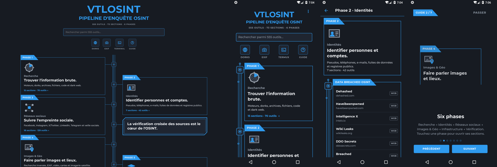
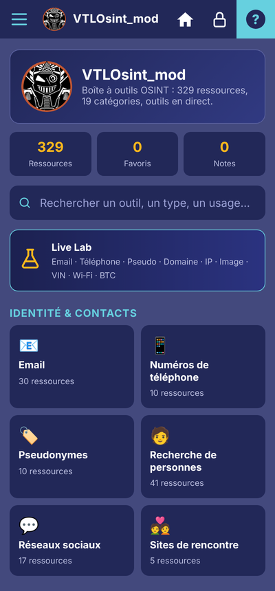
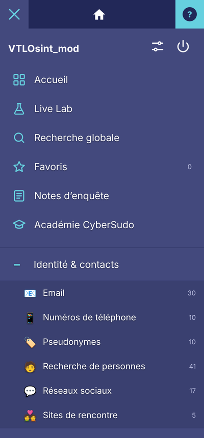
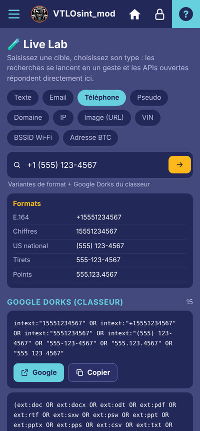

<p align="center"></p>

<h1 align="center">VTLOsint <sub>×</sub> VTLOsint_mod</h1>

<p align="center"><b>Deux APK OSINT, installables côte à côte sur le même téléphone.</b><br>
Le <b>pipeline d'enquête</b> en six phases et le <b>toolkit CyberSudo</b> avec outils en direct.</p>

<table>
<tr>
<td width="50%" valign="top" align="center">
<br>
<h3>APK 1 · VTLOsint</h3>
<sub>Android 8.0+ · application autonome</sub><br><br>
<a href="downloads/VTLOsint.apk?raw=true"></a><br>
<a href="downloads/VTLOsint-web.zip?raw=true"></a><br><br>
555 outils · 73 sections · 6 phases<br>
recherche, favoris, générateur de Google Dorks,<br>lecteur/nettoyeur EXIF, lancement Termux,<br>guide animé en français
</td>
<td width="50%" valign="top" align="center">
<br>
<h3>APK 2 · VTLOsint_mod</h3>
<sub>Android 7.0+ · paquet <code>com.vtlo.osint</code> · mod indépendant</sub><br><br>
<a href="mods/VTLOsint_mod/downloads/VTLOsint_mod.apk?raw=true"></a><br>
<a href="mods/VTLOsint_mod/downloads/VTLOsint_mod.html?raw=true"></a><br><br>
329 ressources · 19 catégories<br>
<b>Live Lab</b> : DNS, RDAP, certificats, IP, VIN, Wi‑Fi…<br>recherche globale, favoris, notes locales,<br>mode privé, navigateur intégré, PWA
</td>
</tr>
</table>

> **Installation** : ouvrez l'APK sur le téléphone et autorisez les sources inconnues. Les deux applications ont des paquets différents : vous pouvez installer **les deux**. Si une très ancienne version de VTLOsint (paquet `io.github.osintcheatsheet`) est présente, désinstallez-la d'abord.

## Quelle APK pour quel besoin ?

| | **APK 1 · VTLOsint** | **APK 2 · VTLOsint_mod** |
| --- | --- | --- |
| Idée | Une enquête = six phases, du brut à la vérification | Un annuaire d'outils + des vérifications lancées en direct |
| Contenu | 555 outils (WEB et TERMINAL) | 329 ressources du classeur CyberSudo |
| Ambiance | Noir `#171B22` · bleu `#2F9BEF` · cartes à onglets `PHASE n` | Marine `#43497D` · turquoise `#66D0DF` · accents jaunes |
| Outils en ligne de commande | Termux (Sherlock, Maigret, GHunt…) | — |
| Requêtes en direct | — | Live Lab (APIs ouvertes) |
| Dorks / EXIF | Générateur de dorks, lecteur/nettoyeur EXIF | Dorks téléphone pré-remplis |
| Favoris | oui | oui, plus notes d'enquête et mode privé |
| Autre version | Application PC (zip) | Fichier HTML unique / PWA |

## Aperçu

**APK 1 · VTLOsint**



**APK 2 · VTLOsint_mod**

<p align="center">  </p>

Détails du mod, compilation et crédits : [`mods/VTLOsint_mod`](mods/VTLOsint_mod/).

## VTLOsint · les six phases

1. **Recherche** — moteurs, dorks, archives, fichiers, code et dark web.
2. **Identités** — pseudos, téléphones, e-mails, fuites de données, registres publics.
3. **Réseaux sociaux** — Facebook, Instagram, X/Twitter, LinkedIn, Telegram, veille sociale.
4. **Images & Géo** — recherche inversée, EXIF, vidéo, cartes, imagerie satellite.
5. **Infrastructure** — domaines, IP, IoT, menaces, serveurs, cryptomonnaies.
6. **Vérification & Arsenal** — fact-checking, frameworks OSINT, outils GitHub, communautés, articles.

Chaque phase regroupe des sections, chaque section liste ses outils :

- **WEB** — s'ouvre dans le navigateur (intégré sur Android, nouvel onglet sur PC).
- **>_ TERMINAL** — Sherlock, Maigret, GHunt, theHarvester… : commande d'installation prête à copier
  pour un terminal PC, ou lancement direct dans [Termux](https://f-droid.org/packages/com.termux/) sur Android.

Aussi inclus : recherche dans tous les outils, favoris, générateur de Google Dorks, lecteur/nettoyeur EXIF
(sans envoi de fichier) et un guide animé en français au premier lancement.

## Termux (Android)

1. Installez Termux depuis [F-Droid](https://f-droid.org/packages/com.termux/) et ouvrez-le une fois.
2. Dans Termux : `mkdir -p ~/.termux && echo 'allow-external-apps = true' >> ~/.termux/termux.properties && termux-reload-settings`
3. Android 10+ : autorisez Termux à s'afficher par-dessus les autres apps.
4. Accordez à VTLOsint la permission « Exécuter des commandes dans Termux » quand elle est demandée.

## Structure du projet

```
data/                 tools.md, articles.md (la liste d'outils) et phases.json (classement en phases)
android/              APK 1 · VTLOsint (Java, sans dépendance)
web/                  VTLOsint PC : src/ (sources), build.py, dist/ (version prête à l'emploi)
downloads/            APK 1 et VTLOsint PC prêts à télécharger
mods/VTLOsint_mod/    APK 2 · VTLOsint_mod : sources web + Android, downloads/ (APK, HTML)
docs/                 bannière animée et captures
```

Pour ajouter un outil, éditez `data/tools.md` : une ligne `- [Nom](https://url) description` sous la bonne
section `# …`. Une nouvelle section est rangée en phase selon les mots-clés de `data/phases.json`.

## Compiler

```sh
python3 web/build.py                        # -> web/dist et downloads/VTLOsint-web.zip
cd android && ./gradlew assembleRelease     # -> app/build/outputs/apk/release/app-release.apk (JDK 17+, SDK 34)
```

La CI GitHub (`.github/workflows/build.yml`) recompile les deux applicatifs à chaque modification de `data/`, `android/` ou `web/`.
L'APK est signé avec la clé de debug Android pour s'installer directement ; signez-le avec votre propre clé pour le distribuer.

❎❎## Run only on authorized target/scope **⚠️Avoid Problems Or be sm@rter than them 🙃✅✅

⤵️ Utilisez ces outils légalement, uniquement sur des cibles que vous êtes autorisé à étudier.
