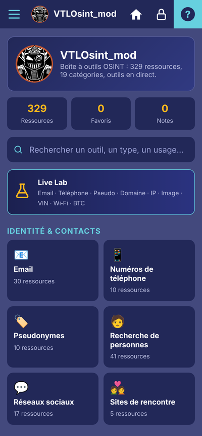
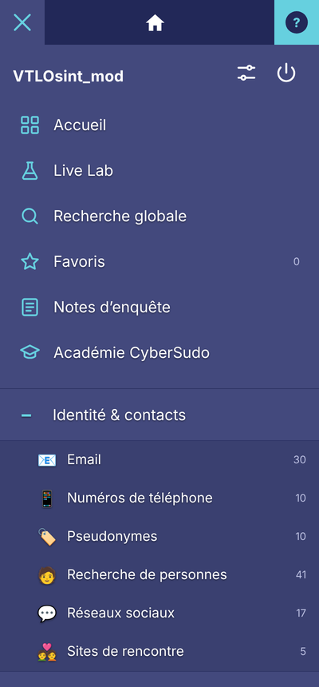
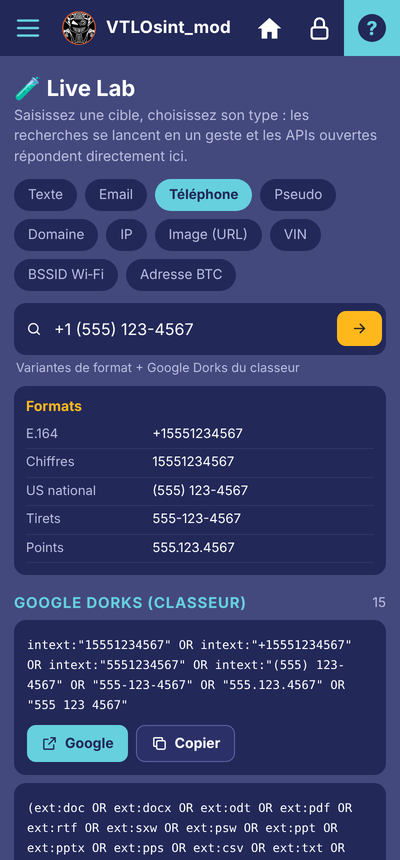

<p align="center"></p>

<p align="center">


<br>

</p>

# ∇TLO · VTLOsint_mod

> Toutes les ressources OSINT d'un classeur, dans une vraie appli. Cherchez, lancez, notez — et laissez les APIs ouvertes répondre en direct.

**VTLOsint_mod** transforme le classeur *CyberSudo's OSINT Toolkit* (24.08.2024) en application mobile : **329 ressources**, **19 catégories**, recherche globale, favoris, notes locales et un **Live Lab** qui interroge des APIs publiques.

<p align="center">
  
</p>

## Installer

| Version | Comment |
|---|---|
| 📱 **APK Android** | Télécharger `VTLOsint_mod.apk` dans les [Releases](../../releases/latest), puis l'installer (sources inconnues à autoriser). |
| 🌐 **Web universel** | Le dossier [`docs/`](docs) est une PWA statique (installable, hors ligne) : à servir avec GitHub Pages. |
| 📄 **Fichier unique** | `VTLOsint_mod.html` dans les Releases : un seul fichier, aucun serveur. |

## Fonctionnalités

- **Catalogue** : tous les outils du classeur (moteurs, email, personnes, téléphone, pseudos, cartes, réseaux sociaux, images, vidéo, entreprises, fuites, forums, documents, véhicules, marketplaces, domaine/IP, rencontres, divers, ressources) avec leurs vrais liens et le badge Gratuit / Partiel / Payant.
- **Live Lab** : email, téléphone, pseudo, domaine, IP, URL d'image, VIN, BSSID Wi‑Fi, adresse BTC.
  - En direct dans l'appli : DNS (Google DoH), RDAP, certificats (crt.sh), Wayback, géolocalisation IP, décodage VIN (NHTSA), Wi‑Fi (mylnikov), EmailRep, Gravatar.
  - Lancement en un geste sur plusieurs dizaines de services ; Google Dorks du classeur pré-remplis pour un numéro.
- **Recherche globale**, **favoris**, **notes d'enquête** (stockées localement), **mode privé**, navigateur intégré (APK).

> Dans un navigateur, certains appels en direct sont bloqués par CORS ; ils fonctionnent dans l'APK.

## Compiler l'APK

```bash
cd android
cp local.properties.example local.properties            # chemin du SDK Android
mkdir -p app/src/main/assets/www && cp -r ../docs/* app/src/main/assets/www/
keytool -genkeypair -keystore ../vtlo.keystore -alias vtlo -keyalg RSA -keysize 2048 -validity 10000
VTLO_KS_PASS=<mot_de_passe> gradle assembleRelease        # JDK 17+, Android SDK 34
```

Les données sont générées par `tools/extract.py` puis `tools/build_data.py` à partir du classeur `.xlsx` (non redistribué ici).

## Crédits & usage

- Données : *CyberSudo's OSINT Toolkit* — [cybersudo.org](https://cybersudo.org/).
- Les liens pointent vers des services tiers : à utiliser dans le respect du droit applicable et de la vie privée des personnes.

Licence **GPL-3.0** · © VTLO
